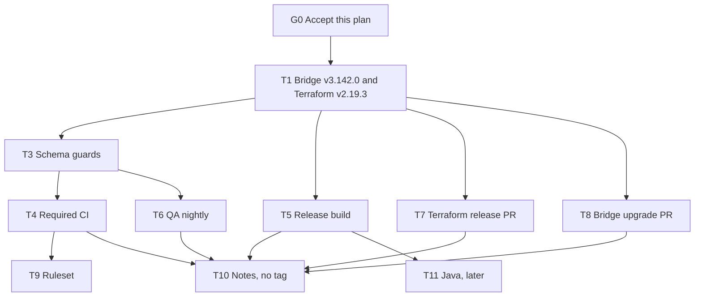

# Refresh the Pulumi Redis Cloud provider

Status: Accepted. G0 accepted by Shay Berman on 1 November 2026.
Owner: Shay Berman.
Date: 1 November 2026.
Ticket: none.
Design: this file.
ADR: [ADR-0001](../adr/ADR-0001-published-bridge-mux.md) (Accepted).
BDR: none. This is a technical refresh of an existing package. No pricing, entitlement, or ownership choice.
Gap review: [pulumi-rediscloud-gap.md](../pulumi-rediscloud-gap.md).

This file is the implementation plan. It is not a Pulumi Registry page. Registry content stays in `docs/`.

## TLDR

Move this package from Pulumi Terraform Bridge v3.60.1 and Terraform v1.3.1 onto bridge v3.142.0 and Terraform v2.19.3, using the mux entrypoints the current Terraform provider requires. Keep the Pulumi names that v1.3.5 already published. Add pull-request checks that do not call Redis Cloud, and a nightly create-and-delete on a QA account that is not a required check. Do not tag a release until the notes pull request is accepted.

## Problem

The published plugin is `pulumi-resource-rediscloud` v1.3.5 (20 December 2023). It bridges Terraform v1.3.1 with bridge v3.60.1. Terraform v2.19.3 (28 October 2026) is muxed: Plugin SDK resources and Plugin Framework resources are one server. `shimv2.NewProvider` cannot load that server, so a `go.mod` bump of the bridge does not compile against v2.19.3.

`make test` does not test the provider. `examples/` has Pulumi integration helpers and no `Test` function, so `go test` passes with nothing to run. The only GitHub workflow is `release.yaml`, and it runs on a tag. Nothing in this repository calls the Cloud API from CI.

The Crossplane provider already closed this feature gap against the same Terraform pin, and its live check is a nightly create-and-delete on the QA Cloud API account. This plan copies that shape.

## Goals

- The provider builds on bridge v3.142.0, Go 1.26.10, and Pulumi v3.273.0, and loads Terraform v2.19.3 through the mux entrypoints.
- The 11 resource tokens and 11 data source tokens from v1.3.5 keep their names.
- `tfgen` emits all 27 managed resources and all 29 data sources from that Terraform tag.
- Every pull request runs lint, a build, a generated-schema check, unit tests, and `govulncheck`, and does not receive a Cloud API key.
- A nightly job on this repository creates and deletes one ACL rule, one Pro subscription, and one database on a QA account, then leaves none of its objects behind.
- A newer Terraform release opens a pull request that changes the pin. A newer bridge release opens a separate pull request. Neither workflow merges, and neither bumps the other component.
- Release notes stay on an open pull request. No git tag.

## Non-goals

- A native Pulumi provider, or telling existing stacks to switch to Any Terraform Provider.
- Running the live suite on pull requests, or making it a required check.
- Peering, Transit Gateway, private link, Private Service Connect, or Active-Active in the live suite. Those need an AWS or GCP account. Terraform already covers them in its own acceptance jobs.
- Minting a throwaway Cloud account per run. The Terraform provider already has that flow. This plan uses one QA account key, the same shape as the Crossplane nightly.
- Adopting `pulumi/ci-mgmt` `run-acceptance-tests.yml` as the Redis Cloud suite. That workflow runs on pull requests and authenticates to Pulumi Cloud.
- Publishing Java in this refresh. The current job targets OSSRH, which shut down on 30 June 2025. The external bridge template leaves Java off. Task T11 is the follow-up.
- A coverage-percentage gate. Generated SDK files would dominate it.
- Tagging v2.0.0, publishing to npm, PyPI, or NuGet, or editing the Pulumi Registry listing.

## Current testing

Checked in this repository on 1 November 2026.

| What exists | What it does |
| --- | --- |
| `make test` | `cd examples && go test -v -tags=all -parallel -timeout 2h` |
| `examples/examples_test.go` | Sets `RunUpdateTest: false` and `ExpectRefreshChanges: true`. No test function. |
| `examples/examples_nodejs_test.go`, `examples/examples_py_test.go` | Option helpers only. The Node helper still lists a dependency on `@pulumi/foo`. |
| `examples/nodejs/index.js` | Sample program: payment method lookup, Pro subscription, database. Nothing invokes it. |
| `.github/workflows/` | `release.yaml` only. No pull-request workflow. |

A green `make test` today means the helpers compiled. It does not mean a resource can be created.

## Proposed behavior

### Versions

| Piece | This repo today | This refresh |
| --- | --- | --- |
| Pulumi Terraform Bridge | v3.60.1 | v3.142.0, released 27 October 2026. Latest release on 1 November 2026. Same pin as `pulumi/pulumi-tf-provider-boilerplate` `main`. |
| Pulumi `pkg` / `sdk` | provider sdk v3.81.0, checked-in Go SDK v3.38.0 | v3.273.0 |
| Go | 1.18 in `provider/go.mod`, 1.19 and 1.20 in the release job | 1.26.10 |
| Terraform provider | v1.3.1 | v2.19.3 |
| Plugin SDK | Pulumi fork, via a `replace` | Upstream, which bridge v3.141 already uses. Delete the `replace`. |
| Entrypoint | `shimv2.NewProvider(rediscloud.New("pulumi")())` | `pftfbridge.MuxShimWithDisjointgPF`, then `pf/tfgen.MainWithMuxer` and `pf/tfbridge.MainWithMuxer` |

Bridge v3.142.0 is a direct dependency of this module. It is not updated by moving the Terraform pin. Task T1 changes it in the same pull request as Terraform, because the old entrypoint cannot load the muxed provider and the new entrypoint is what v2.19.3 needs. Later bridge bumps are task T8, and they do not move Terraform.

`MainWithMuxer` is marked experimental in the bridge tree. Pulumi's own guide says production providers use it. ADR-0001 records that.

### Tokens

Keep these resource names: `CloudAccount`, `Subscription`, `SubscriptionDatabase`, `SubscriptionPeering`, `ActiveActiveSubscription`, `ActiveActiveSubscriptionDatabase`, `ActiveActiveSubscriptionPeering`, `ActiveActiveSubscriptionRegions`, `AclUser`, `AclRole`, `AclRule`.

Keep these data source names: `getCloudAccount`, `getDataPersistence`, `getDatabase`, `getDatabaseModules`, `getPaymentMethod`, `getRegions`, `getSubscription`, `getSubscriptionPeerings`, `getAclUser`, `getAclRole`, `getAclRule`.

New Terraform resources get computed tokens, with `MustApplyAutoAliases` so a later mapping change keeps the old name. The hand-written map for the eleven existing resources stays, so a computed name cannot replace `Subscription`.

`api_key` reads `REDISCLOUD_ACCESS_KEY` first, then `REDISCLOUD_API_KEY`. `REDISCLOUD_ACCESS_KEY` wins when both are set. `REDISCLOUD_API_KEY` remains so a v1.3.5 setup that only sets that name keeps working, and it is deprecated. `secret_key` stays `REDISCLOUD_SECRET_KEY`. `url` reads `REDISCLOUD_URL`.

The v2.19.3 constructors take a version string and hardcode the product name `terraform-provider-rediscloud`. T1 passes this provider's version and does not rename the product. A different product name needs a change in the Terraform provider.

### Testing concept

Same split as the Crossplane provider in `docs/design/testing-gate.md` and `docs/design/test-suites.md`.

| Suite | When | Redis Cloud account |
| --- | --- | --- |
| CI | Every pull request. Required check is `ci-success` only, after T9. | None. |
| Acceptance smoke | Nightly at 08:17 UTC, and Actions → Run workflow. Not a required check. A red run does not unmerge. | QA account Cloud API key. |
| Wider acceptance | Not scheduled. | Not this plan. |
| Optional live comment | Not in this plan. Crossplane's Uptest has no Pulumi equivalent worth adding before the nightly is green. | |

The smoke creates and deletes, in this order:

1. Refuse to start unless `REDISCLOUD_URL` parses as HTTPS and the hostname is not `api.redislabs.com` and does not end with `.api.redislabs.com`. Compare the parsed hostname, so a trailing slash or a different path cannot pass. The QA account is selected by the URL in the secret. A missing URL must not fall through to production.
2. Refuse to start when a subscription name already begins with `pulumi-ci-`.
3. Read the payment method, the Essentials plan, and the regions. These are data sources. They do not create resources.
4. Create one ACL rule named `pulumi-ci-<run id>`, confirm it, delete it, and confirm the name is gone.
5. Create one Pro subscription named `pulumi-ci-<run id>` with a fresh CIDR, the payment method id from the lookup, a dataset size, and `operations-per-second`. Wait until Cloud status is `active`.
6. Create one database on that subscription. Wait until Cloud status is `active`. Read the outputs `publicEndpoint` and `privateEndpoint`. Do not print their values. Do not require `port`.
7. Destroy the stack. Confirm the database and the subscription return HTTP 404.

The name prefix is `pulumi-ci-`. The job refuses to start when a subscription with that prefix already exists. The CIDR picker skips every deployment CIDR already present on the account. Reserved ranges are not listed in this file.

The Pulumi program expresses the database's `subscriptionId` from the subscription output. A wrapper script owns the refuse, the CIDR choice, the 404 check, and the cleanup. Hermetic tests drive that script with a fake API. They do not call Redis Cloud. Those tests run in CI.

The credential is a GitHub Actions secret on this repository, JSON with `api_key`, `secret_key`, and `url`. The workflow maps those fields to `REDISCLOUD_ACCESS_KEY`, `REDISCLOUD_SECRET_KEY`, and `REDISCLOUD_URL` inside the job. The workflow file contains the secret reference, not the value. Pull requests and forks cannot start the workflow: the triggers are `schedule` and `workflow_dispatch` only.

Schedule `17 8 * * *`. That is two hours after the public Crossplane nightly at 06:17 UTC.

Logs print status codes and output names. They do not print the key, the secret, the payment method id, or endpoint values.

### Release tracking

After T1, two workflows:

- Terraform. Once a day, compare the pin with the newest `RedisLabs/terraform-provider-rediscloud` release. If it is newer, open a pull request that changes only that pin. Do not run `tfgen`. Do not bump the bridge, Go, or Pulumi. Do not merge.
- Bridge. `workflow_dispatch`, and a weekly schedule, open a pull request when `github.com/pulumi/pulumi-terraform-bridge/v3` has a release newer than the pin. Do not bump Terraform. Do not merge. The first jump, v3.60.1 to v3.142.0, is T1. This workflow is only for the next release after T1 is on `main`.

### Publication

No tag in this plan. The replacement release workflow must be able to build the plugin and the Node.js, Python, Go, and .NET SDKs, and it must not run on the current Node 20 actions runtime. GoReleaser v2 uses `--clean`. Java is not published. v1.3.5 remains the latest installable release until a later decision tags v2.0.0.

The unpublished notes describe the behavior changes that make this a new major even with the same tokens: `payment_method` ignored after create, `redis_version` on the database, and the Terraform defaults for `auto_minor_version_upgrade`, `source_ips`, and `enable_default_user`.

## Tasks

Each task is one pull request unless the exit criteria say otherwise. A task does not start until every task in **Depends** has merged. Tasks in the same wave edit different files.

### G0. Accept the plan

Depends: nothing.
Wave: 0. Human.

Accepted by Shay Berman on 1 November 2026. T1 may start. This acceptance does not publish a release.

### T1. Bridge, mux, and Terraform v2.19.3

Depends: G0.
Wave: 1. Nothing else runs in this wave.
Edits: `provider/`, `sdk/go/`, `Makefile`, `go.mod` files, and the alignment note in `analysis/pulumi-rediscloud-gap.md`. No other task edits the Makefile.

One pull request. G0 is already Accepted. This pull request does not change that decision.

- Set `provider/go.mod` to Go 1.26.10, bridge v3.142.0, `github.com/pulumi/pulumi/pkg/v3` v3.273.0, and `terraform-provider-rediscloud` v2.19.3.
- Delete the `replace` of `github.com/hashicorp/terraform-plugin-sdk/v2`.
- Replace `shimv2.NewProvider` with `MuxShimWithDisjointgPF`. Generate with `pf/tfgen.MainWithMuxer`. Serve with `pf/tfbridge.MainWithMuxer`. Embed `bridge-metadata.json`.
- Keep the eleven resource tokens and eleven data source tokens listed above. Compute tokens for everything new. Apply auto aliases.
- Add `url` to the bridge `Config` with default env `REDISCLOUD_URL`. Point `api_key` at `REDISCLOUD_ACCESS_KEY`, then `REDISCLOUD_API_KEY`. `REDISCLOUD_ACCESS_KEY` wins when both are set. `REDISCLOUD_API_KEY` stays for existing setups and is deprecated. There is no `url` entry in `Config` today.
- Pass this provider's version to the v2.19.3 constructor. Leave the product name `terraform-provider-rediscloud`, which that constructor hardcodes.
- `make test` runs `go test` in `provider/` and `python3 -m unittest discover -s scripts -p '*_test.py'` when `scripts/` exists. The examples package is no longer the only test root. Later tasks drop tests into `provider/` or `scripts/` and do not edit this target.
- `build_python` uses `python -m build`, matching the current bridge template. It does not call `setup.py`.
- `build_sdks` does not call `build_java`. The Java target may remain unused.
- Run `tfgen`. Check in the Go SDK and `schema.json`.
- Record the pin v2.19.3 and bridge v3.142.0 in the gap review.

Exit:

- `make provider` and `make tfgen` succeed.
- The schema lists 27 resources and 29 data sources.
- A unit test fails if any of the eleven old tokens is renamed, and fails if the loader is `shimv2.NewProvider`.
- `git grep` finds no Plugin SDK `replace`. `api_key` lists `REDISCLOUD_ACCESS_KEY` before `REDISCLOUD_API_KEY`.
- `make test` runs the provider package. It does not call Redis Cloud.
- No workflow file, no tag, no live Cloud API call.

### T3. Schema guards and the example shape

Depends: T1.
Wave: 2, beside T5, T7, and T8.
Edits: `examples/`, `provider/*_test.go`. Does not edit the Makefile or `.github/workflows/`. `make test` already runs the provider package, from T1.

- Replace the `@pulumi/foo` helper. Delete helpers that no test calls.
- A test loads the subscription example and asserts a payment method id, a dataset size, and `operations-per-second`. The payment method id in git stays a placeholder. The QA account's payment method id stays out of git.
- A test asserts the sixteen resources that v1.3.1 did not have are present in the schema: Essentials subscription and database, Private Service Connect and endpoints for Pro and Active-Active, private link for Pro and Active-Active, Transit Gateway attachments, routes, and invitation acceptors for Pro and Active-Active.
- `make test` runs these tests and does not call Redis Cloud.

Exit: removing the payment method id from the example fails `make test`. Restoring it passes. No secret and no real payment method id in the diff.

### T5. Release build, still no tag

Depends: T1.
Wave: 2, beside T3, T7, and T8.
Edits: `.github/workflows/release.yaml`, `.github/workflows/build.yaml`, `.goreleaser.yml`. Does not edit the Makefile or `provider/resources.go`. Python packaging and the Java omission are already in the Makefile from T1.

`release.yaml` today sets `NPM_PUBLISH`, `PYPI_PUBLISH`, and `JAVA_PUBLISH` to true and runs on a tag. Do not add `workflow_dispatch` to that file. A dispatch on it would publish.

- Add `build.yaml`, triggered only by `workflow_dispatch`. It builds the plugin with `goreleaser build --clean --snapshot` and builds the Node.js, Python, Go, and .NET SDKs. It does not publish, does not create a GitHub release, and does not create an `sdk/` tag.
- Update `release.yaml` so a future tag uses current actions, Go 1.26.10, Node 24, Python 3.13, and GoReleaser v2 `--clean`. Set `JAVA_PUBLISH` to false. Leave `NUGET_PUBLISH` false. The `on` key stays `push` of `v*.*.*`. Do not push a tag in this task.
- .NET 10 is the SDK image if the job still builds a package and does not publish it. .NET 8 and 9 end support on 10 November 2026.

Exit: the dispatch build is green. `release.yaml` has no `workflow_dispatch` trigger. `JAVA_PUBLISH` is false. No step reads a Cloud API key.

### T7. Terraform release pull request

Depends: T1.
Wave: 2, beside T3, T5, and T8.
Edits: `.github/workflows/terraform-release.yaml`, `scripts/track_terraform_release.py`, and `scripts/track_terraform_release_test.py`. Does not edit the Makefile, `ci.yml`, or the bridge workflow. `make test` discovers `scripts/*_test.py` from T1, so T4 does not need a new edge to run this test.

The workflow runs on a schedule and on `workflow_dispatch`. A newer Terraform release opens a pull request that changes only the pin. The same pin opens nothing. The pull request body says a person regenerates and reviews. The workflow does not merge and does not change the bridge version.

Exit: a hermetic test covers "same pin opens nothing" and "newer tag changes only the pin". The workflow file has no `pull_request` trigger.

### T8. Later bridge upgrades

Depends: T1.
Wave: 2, beside T3, T5, and T7.
Edits: `.github/workflows/upgrade-bridge.yaml`. Does not edit `terraform-release.yaml` or `provider/`.

This is not how v3.60.1 becomes v3.142.0. T1 already did that, because the entrypoint has to change.

After T1, this workflow opens a pull request when a newer bridge release exists. The only module edit is `go get` of `github.com/pulumi/pulumi-terraform-bridge/v3` and `go mod tidy` in `provider/`. It does not copy files from `pulumi/ci-mgmt` or the bridge template, and it does not rewrite `provider/resources.go` or `provider/cmd/`. A template sync would replace the mux entrypoints with a single-shim provider. It does not bump Terraform or Go, and it does not merge. Trigger: weekly schedule and `workflow_dispatch`. Default is a pull request, not automerge.

Exit: the workflow file cannot run on `pull_request`. The file says the edit is the module bump only. The T1 test that rejects `shimv2.NewProvider` is the guard against a later sync.

### T4. Required pull-request CI

Depends: T3.
Wave: 3, beside T6.
Edits: `.github/workflows/ci.yml`. Does not edit the nightly workflow.

Jobs: lint, provider build, `tfgen` diff, `make test`, `govulncheck`. A final job `ci-success` depends on those. A docs-only pull request skips them and still passes `ci-success`. A failed job fails `ci-success`. No Cloud API secret. No Pulumi Cloud login.

Exit: `ci-success` is green on this pull request. The job's `needs` list does not include the nightly workflow.

### T6. QA nightly acceptance

Depends: T3.
Wave: 3, beside T4.
Edits: `.github/workflows/qa-live.yaml`, `scripts/qa_live.py`, `scripts/qa_live_test.py`, and a Go program at `examples/qa/`. Does not edit `ci.yml` or the Makefile. `examples/qa/go.mod` replaces the SDK with this repository's `sdk/` module. The program creates the ACL rule, the Pro subscription, and the database, with the database subscription id taken from the subscription output. The wrapper implements the refuse, CIDR, cleanup, and HTTP 404 checks from [Proposed behavior](#testing-concept).

The job does not log in to Pulumi Cloud and does not download a plugin from GitHub Releases. `PluginDownloadURL` would fetch v1.3.5, because this plan does not publish a newer plugin. The wrapper builds `bin/pulumi-resource-rediscloud`, runs `pulumi plugin install resource rediscloud --file` on that binary, runs `pulumi login --local`, and sets `PULUMI_CONFIG_PASSPHRASE` to empty so the secret config does not prompt. State stays on the runner.

The workflow triggers are `schedule` (`17 8 * * *`) and `workflow_dispatch`. Concurrency group `qa-live`, cancel in progress false. Timeout 120 minutes. An `always()` cleanup deletes only the `pulumi-ci-<this run id>` subscription this run created. It leaves any other `pulumi-ci-` name alone. The Makefile is unchanged. `make test` picks up `scripts/qa_live_test.py`.

Before merge, the secret exists in this repository's Actions secrets. Do not print it. One local run, or one `workflow_dispatch` after the secret is present, completes the live order and leaves no `pulumi-ci-` subscription. The first scheduled run is after merge.

Exit:

- Hermetic tests: an existing `pulumi-ci-` subscription refuses create; a failed database step still deletes the subscription this run created; success requires Cloud `active`, both endpoint output names, and HTTP 404; an empty URL, a non-HTTPS URL, and a hostname of `api.redislabs.com` with any path or trailing slash refuse before create.
- The workflow YAML has no `pull_request` key.
- The live run's result is recorded in the pull request as: lookups returned, ACL created and gone, subscription active then 404, database active then 404, endpoint names present. No values.

A red nightly run is fixed with a follow-up pull request. It does not block other pull requests.

### T9. Ruleset

Depends: T4 merged, and one green `ci-success` on `main`.
Wave: 4, beside T10 and T11.
No application diff. Repository setting.

Require `ci-success` on `main`. Do not require the nightly workflow, the Terraform tracker, or the bridge tracker. Apply the ruleset after T4's check name has been seen on `main`. Revert by deleting the ruleset before reverting the workflow. The other order blocks merges.

### T10. Unreleased notes

Depends: T4, T5, T6, T7, T8.
Wave: 4, beside T9 and T11.
Edits: `analysis/release-notes/unreleased.md` only.

One pull request, left open, same rule as Crossplane pull request 20. The body says not to merge and not to tag. The notes compare v1.3.5 with the refresh: bridge v3.60.1 to v3.142.0, Terraform v1.3.1 to v2.19.3, 11 resources to 27, 11 data sources to 29, the nightly suite, and the behavior changes listed under Publication. They say Java is not in this refresh.

Exit: the pull request is open, the file is the only change, and no tag exists.

### T11. Java

Depends: T5.
Wave: 4, beside T9 and T10. Not on the path to T10.

Publish `com.redislabs` through the Maven Central Portal, on a later decision. Until that pull request, the release workflow does not publish Java, and the notes say so.

## What can run at the same time

| Wave | Tasks | Why they do not collide |
| --- | --- | --- |
| 0 | G0 | Decision only. |
| 1 | T1 | The provider entrypoint, the Terraform pin, and the bridge pin land together. Splitting them does not compile. |
| 2 | T3, T5, T7, T8 | Tests and examples, the release and build workflows, and the two tracker workflows are different files. The Makefile is finished in T1, so this wave does not edit it. T7 and T6 use different script names, so their tests do not share a file. |
| 3 | T4, T6 | `ci.yml` and `qa-live.yaml` are different files. T6 waits for T3 so the example shape is already enforced. |
| 4 | T9, T10, T11 | A repository setting, a notes file, and a later Java change. |

T2 is not a task. The pin note is an exit check of T1, so the tracker cannot lag the code.

## Security and operational impact

The QA account key lives in a GitHub Actions secret and, for the one local run, in a file outside the repository. T6 is the only workflow that reads it. A fork cannot start that workflow.

The job may hold one Pro subscription for the length of the run. The Crossplane run on 27 October 2026 was under 20 minutes to create and under 5 minutes to delete. This job refuses to start when a `pulumi-ci-` subscription already exists. Cleanup deletes only the subscription this run created. A later run does not delete a leftover from an earlier failure.

v1.3.5 stays published. Merging T1 does not change what `pulumi plugin install` downloads until a tag exists, and this plan does not create a tag.

## Rollout and rollback

Merge T1, then the wave 2 pull requests in any order, then T4 and T6 in either order, then enable the ruleset, then open T10 and leave it open. T11 waits.

Rollback of a merged task is reverting that merge. Delete the ruleset before reverting T4. There is no published artifact to roll back. Users stay on v1.3.5.

## Open questions

- The QA account base URL is the secret's `url` field. T6 refuses the production host. The URL is not written in this repository.
- The secret is a Cloud API key for that non-production account. This file does not say which account, and it does not copy a key from another repository.
- NuGet stays unpublished, as it is today. Turning it on is a later decision, with .NET 10 because .NET 8 and 9 end support on 10 November 2026.

## Validation

T1 is validated by a local build and the token test. T3 and T7 are validated by `make test` without a Cloud API key. T5 is validated by a dispatch build that does not publish. T6 is validated by hermetic tests plus one live run. T4 is validated by a green `ci-success`. T10 is validated by reading the notes and confirming no tag.

No task was executed for this document. The provider was not compiled.

## Review

Reviewed on 1 November 2026 against ADR-0001, the gap review, `provider/go.mod`, `provider/resources.go`, the Makefile, and the example tests. The task graph is unchanged.

Kept:

- T1 owns the Makefile: provider tests, discovery of `scripts/*_test.py`, `python -m build`, and no Java in `build_sdks`. Wave 2 does not edit the Makefile, so T3 and T5 do not collide there.
- T6 runs `pulumi login --local`, an empty `PULUMI_CONFIG_PASSPHRASE`, and the binary built in the job. The published plugin URL would otherwise install v1.3.5.
- The production-URL check parses the hostname. A trailing slash does not pass.
- T5 proves the build with a separate `build.yaml`. `release.yaml` stays tag-only, and `JAVA_PUBLISH` is false. Adding `workflow_dispatch` to today's release workflow would publish, because `NPM_PUBLISH` and `PYPI_PUBLISH` are true.
- T8 may change the bridge module version only. It does not copy the bridge template over the mux entrypoints. The T1 test rejects `shimv2.NewProvider`.
- `url` is added to bridge `Config`. It is absent today.

Rejected:

- An edge `T3 → T7 → T4`. T1's test discovery already runs a script test added later. The extra edge would stop T7 from running beside T3.
- Marking ADR-0001 Accepted during the review itself. Shay Berman accepted G0 on 1 November 2026. This file and ADR-0001 are Accepted. T1 does not reopen the decision.

Bridge v3.142.0 and Terraform v2.19.3 belong in one pull request. Splitting them does not compile.
